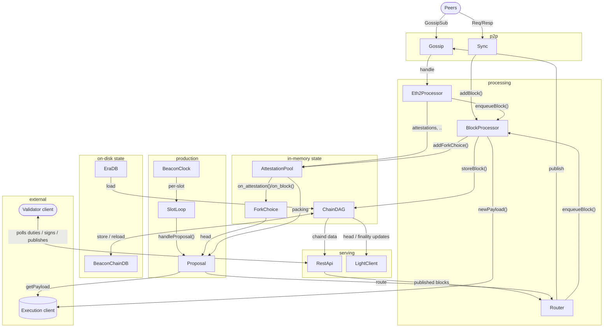

# Beacon Node Architecture

This is a WIP document to give an overview of the principal architectural
components of the Nimbus beacon node. The detailed message flows are
described in dedicated pages:

- [Attestation Flow](./attestation_flow.md) — how attestations, sync committee
  messages, payload attestations and validator changes are validated, pooled
  and fed into fork choice and block production
- [Beacon Block Flow](./block_flow.md) — how blocks are received, validated,
  quarantined, cleared and stored
- [Beacon Block Production Flow](./block_production_flow.md) — how a validator
  duty turns into a signed block, including execution client and MEV builder
  contact

## Overview

How the principal components interact at a high level:

## Components

### Message processing

- `Eth2Processor` — single entry point for all inbound gossip and RPC
  messages; performs P2P-spec validation and batched signature
  verification via `BatchCrypto` before handing messages to the pools.
  See [Attestation Flow](./attestation_flow.md) and
  [Beacon Block Flow](./block_flow.md).
- `BlockProcessor` — moves blocks from "incoming" to "consensus verified";
  receives blocks from all sources — gossip (via the `Eth2Processor`), sync
  (via `SyncOverseer2`), the REST API and local validator proposals (via the
  `MessageRouter`) — and serializes all block stores through a single
  `storeLock`, feeding the clearance, the DAG and the quarantines.
  See [Beacon Block Flow](./block_flow.md).

### State

- `ChainDAGRef` — the in-memory DAG of recent epochs, backed by an SQLite
  [database](../beacon_chain/beacon_chain_db.nim) and
  [on-disk era store](./e2store.md) (append-only TLV files) for older
  epochs and finalized blocks; blocks and states are
  persisted there and reloaded on demand.
- `ForkChoice` — ProtoArray-based fork choice tracking
  attestations for head selection, including fast confirmation
  ([implementation](../beacon_chain/fork_choice/fork_choice.nim)).
- The message pools (`AttestationPool`, `SyncCommitteeMsgPool`,
  `PayloadAttestationPool`, `ValidatorChangePool`) and the block
  quarantines (`Quarantine`, `EnvelopeQuarantine`, column quarantines) —
  see the [Attestation Flow](./attestation_flow.md) and
  [Beacon Block Flow](./block_flow.md) pages.

### Block production

- `SlotLoop` / `Proposal` / `BlockPayloads` — the per-slot duty loop and
  block assembly. See [Beacon Block Production Flow](./block_production_flow.md).
- `ELManager` — the execution client connection pool (Engine API).
  See [Beacon Block Production Flow](./block_production_flow.md).
- `BeaconClock` — tracks beacon time (slots) against the chain's genesis
  offset and drives the per-slot duty loop
  ([implementation](../beacon_chain/beacon_clock.nim)).

### Validator client

- The validator client is a separate process that holds the validator keys
  (local keystores or an external signer such as web3signer via the key
  manager API) and executes the signing duties — attestation, aggregation,
  sync committee, PTC and block signing. The beacon node is passive in this
  exchange: the validator client polls it through the validator REST API for
  duties and for blocks to sign, may feed blocks back in via the same API
  (e.g. when it produced a block itself) and reads DAG data through it as
  well ([duties](../beacon_chain/validators/validator_duties.nim)).
- Slashing protection — a local database that rejects any signature
  conflicting with a previously registered one, checked before every
  signature is requested
  ([implementation](../beacon_chain/validators/slashing_protection_v2.nim)).

### Networking & sync

- `Networking` — the libp2p stack: GossipSub for broadcast topics,
  discv5 for peer discovery and peer scoring to keep a quality peer pool;
  received data is handed to the `Eth2Processor` for validation
  ([implementation](../beacon_chain/networking/eth2_network.nim)).
- `Sync` — `SyncOverseer2` drives range, root and sidecar sync (including
  PeerDAS custody) when the node is behind, and re-requests missing
  dependencies from the quarantines
  ([implementation](../beacon_chain/sync/sync_overseer2.nim)).

### Serving

- The REST API — the beacon, validator, builder, debug, config and
  light-client endpoints; this is also the interface the validator client
  uses to fetch duties and submit signatures
  ([implementation](../beacon_chain/rpc/rest_api.nim)).
- `LightClient` — produces and serves head and finality updates to light
  clients from the `BeaconChainDB`
  ([implementation](../beacon_chain/beacon_node_light_client.nim)).
