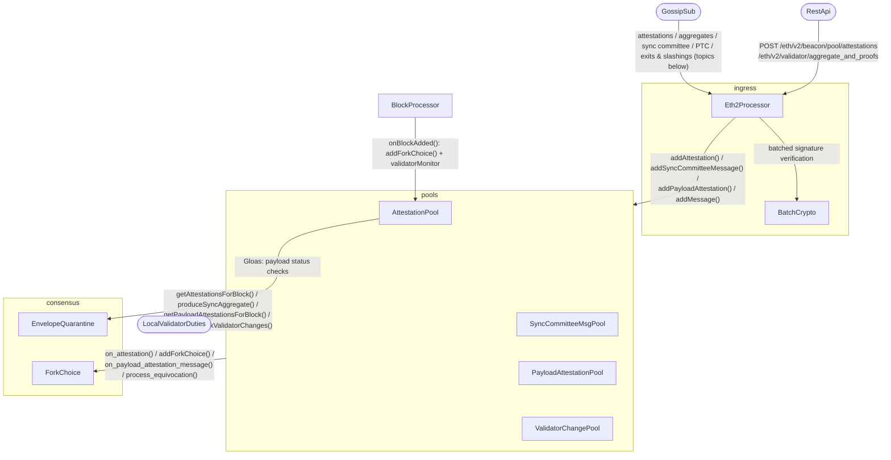

# Attestation Flow

This is a WIP document to explain the attestation flows.

## Validation & Verification flow

It is important to distinguish attestation `validation` from attestation `verification`.
- Attestation `validation` is defined in the P2P specs. Validated attestations can be forwarded on GossipSub.
  - Aggregated: https://github.com/ethereum/consensus-specs/blob/v1.7.0-beta.0/specs/phase0/p2p-interface.md#beacon_aggregate_and_proof
  - Unaggregated: https://github.com/ethereum/consensus-specs/blob/v1.7.0-beta.0/specs/phase0/p2p-interface.md#attestation-subnets
- Attestation `verification` is defined in the consensus specs. Verified attestations can affect fork choice and may be included in a block.
  - https://github.com/ethereum/consensus-specs/blob/v1.7.0-beta.0/specs/phase0/beacon-chain.md#attestations

From the specs it seems like gossip attestation `validation` is a superset of consensus attestation `verification`.

### Inputs

Attestations can be received from the following sources:
- GossipSub
  - Aggregated: `/eth2/{$forkDigest}/beacon_aggregate_and_proof/ssz_snappy`
  - Unaggregated: `/eth2/{$forkDigest}/beacon_attestation_{subnetIndex}/ssz_snappy`
  - Payload attestations (Gloas+): `/eth2/{$forkDigest}/payload_attestation_message/ssz_snappy`
  - Sync committee messages: `/eth2/{$forkDigest}/sync_committee_{subcommitteeIdx}/ssz_snappy`
  - Sync committee contributions: `/eth2/{$forkDigest}/sync_committee_contribution_and_proof/ssz_snappy`
- within received blocks
- the NBC database (within a block)
- [REST API](https://ethereum.github.io/beacon-APIs/#/Validator)
  - `POST /eth/v2/beacon/pool/attestations` (single attestations)
  - `POST /eth/v2/validator/aggregate_and_proofs` (aggregates)
  - `POST /eth/v1/beacon/pool/sync_committees` (sync committee messages)
  - `POST /eth/v1/validator/contribution_and_proofs` (sync committee contributions)
- a local validator vote
- dev tools: test suite, ncli, fuzzing

The related base types are
- `Attestation`
- `SingleAttestation` (Gloas+, one vote of a committee member)
- `IndexedAttestation`
- `PayloadAttestation` (Gloas+, participation-tracking-committee vote on payload availability)
- `SyncCommitteeMessage` / `SyncCommitteeContribution` / `SyncAggregate`

The base types are defined in the Eth2 specs. On top of these, Nimbus adds further types to represent the level of trust and validation / verification of attestations with regards to each BeaconBlock. Those additional types allow the Nim compiler to help ensuring proper usage at compile time without introducing runtime cost.

#### TrustedAttestation & TrustedIndexedAttestation

An `Attestation` or `IndexedAttestation` that was successfully verified as per the consensus spec, or that was retrieved from a trusted source of blocks, e.g., the database, is considered trusted. The signature is assumed to have been already verified.

## Attestation processing architecture

This diagram visualizes how the various modules interact with attestations:

Attestations no longer pass through an intermediate queue in the Eth2Processor:
they are validated (with batched signature verification) and pushed straight
into the `AttestationPool`, which feeds fork choice and block production.

### Inbound gossip flow

These GossipSub topics are used to listen for attestations:
- Aggregated: `/eth2/{$forkDigest}/beacon_aggregate_and_proof/ssz_snappy`
- Unaggregated: `/eth2/{$forkDigest}/beacon_attestation_{subnetIndex}/ssz_snappy`
- Sync committee messages: `/eth2/{$forkDigest}/sync_committee_{subcommitteeIdx}/ssz_snappy`
- Sync committee contributions: `/eth2/{$forkDigest}/sync_committee_contribution_and_proof/ssz_snappy`
- Payload attestations (Gloas+): `/eth2/{$forkDigest}/payload_attestation_message/ssz_snappy`

Unaggregated attestations are validated by `processAttestation` in the
Eth2Processor which calls `validateAttestation` (in [gossip validation](../beacon_chain/gossip_processing/gossip_validation.nim),
invoked with the `AttestationPool`, the `BatchCrypto` and the
`EnvelopeQuarantine`); aggregates by `processSignedAggregateAndProof` which
calls `validateAggregate` — both according to the P2P specs.
- https://github.com/ethereum/consensus-specs/blob/v1.7.0-beta.0/specs/phase0/p2p-interface.md#beacon_aggregate_and_proof
- https://github.com/ethereum/consensus-specs/blob/v1.7.0-beta.0/specs/phase0/p2p-interface.md#attestation-subnets

Signature verification is batched via the [`BatchCrypto`](../beacon_chain/gossip_processing/batch_validation.nim): multiple signature sets are
collected and verified together once a batch is full
(`BatchedCryptoSize = 72`) or after an accumulation window elapses
(`BatchAttAccumTime = 10.milliseconds`), using `InflightVerifications = 2`
concurrent verifier threads. A batch older than one slot is pruned
(`notice "Batch queue pruned, skipping attestation validation"`). Eager
verification only runs when no block is pending
(`batchCrypto` is constructed with `eager = not blockProcessor.hasBlocks()`).

Finally, valid attestations are added to the local `AttestationPool` via
`addAttestation` (which deduplicates and aggregates per attestation data, and
feeds fork choice via `forkChoice.on_attestation`) and dropped in case of an
error.

Logs:
- debug: "SingleAttestation received" / "Aggregate received"
- trace: "SingleAttestation validated" / "Aggregate validated"
- debug: "Dropping attestation" / "Dropping aggregate"
- debug: "SingleAttestation resolved" / "Aggregate resolved"

Sync committee messages and contributions are validated by
`processSyncCommitteeMessage` / `processSignedContributionAndProof` (via
`validateSyncCommitteeMessage` / `validateContribution`) and added to the
`SyncCommitteeMsgPool` ([its implementation](../beacon_chain/consensus_object_pools/sync_committee_msg_pool.nim)), which aggregates them
into `SyncAggregate`s for block production only — they do not feed fork choice.

Payload attestations are validated by `processPayloadAttestationMessage` (via
`validatePayloadAttestationMessage`) and added to the `PayloadAttestationPool`
([its implementation](../beacon_chain/consensus_object_pools/payload_attestation_pool.nim), Gloas+ PTC); they are recorded in fork choice
via `forkChoice.on_payload_attestation_message`.

Voluntary exits, proposer slashings, attester slashings and BLS-to-execution
changes are validated by `processSignedVoluntaryExit` /
`processProposerSlashing` / `processAttesterSlashing` /
`processBlsToExecutionChange` and added to the `ValidatorChangePool`
([its implementation](../beacon_chain/consensus_object_pools/validator_change_pool.nim)), which holds them for block production
(`getBeaconBlockValidatorChanges`); attester slashings also feed fork choice
via `process_equivocation`.

### Outbound gossip flow

After validation in `processAttestation` or `processSignedAggregateAndProof` in eth2_processor
- We jump into method `validate(PubSub, Message)` in libp2p/protocols/pubsub/pubsub.nim
- which was called by `rpcHandler(GossipSub, PubSubPeer, RPCMsg)`

### Consensus RPC in

Attestations can be published via the beacon/validator APIs — they go through
the `MessageRouter` (`routeAttestation`, `routeSignedAggregateAndProof`,
`routeSyncCommitteeMessages`, `routeSignedContributionAndProof`) which
validates them via the same `Eth2Processor` entry points as gossip and then
broadcasts them on the network.

### Attestation pool

The `AttestationPool` ([its implementation](../beacon_chain/consensus_object_pools/attestation_pool.nim)) holds
gossip-validated attestations in a ring buffer of `ATTESTATION_LOOKBACK =
SLOTS_PER_EPOCH + MIN_ATTESTATION_INCLUSION_DELAY` slot tables, keyed by
`(attestation_data_root, committee_index)`. Each entry aggregates single votes
and aggregate signatures (subsumed aggregates are dropped, singles are merged
into aggregates lazily). It serves two consumers:

- fork choice: `forkChoice.on_attestation` for gossip attestations and
  `forkChoice.process_block` for in-block attestations (via
  `attestationPool.addForkChoice` from the block processor's `onBlockAdded`
  callback); `selectOptimisticHead` runs fork choice to pick the head
- block production: `getAttestationsForBlock` packs the best compatible
  attestations into a new block (`debug "Packed attestations for block"`);
  aggregators use `getElectraAggregatedAttestation` /
  `getGloasAggregatedAttestation` for the construct-aggregate duty

### Sync vs Steady State

During sync the only attestations we receive are included in synced blocks.
Afterwards attestations come from GossipSub.

#### Bottlenecks during sync

Verifying attestations only consumes a small share of block processing time. Attestation processing is not a bottleneck during sync.

##### Latency & Throughput sensitiveness

We distinguish aggregation of attestations from batched validation:
- aggregation of attestations is defined by the consensus specs. When multiple validators sign the same attestation, their individual signatures may be combined into an aggregate signature to save storage space and to reduce validation time. The aggregate signature is exchanged over the P2P network and included in blocks, but the aggregate public key is computed on-the-fly based on the individual validator public keys according to a participation bitfield.
- batched validation is an opportunistic client side optimization. Multiple attestations of the same underlying data are collected and processed as a batch once a threshold of them has been received or after a time limit is exceeded. As part of this batched validation, both the aggregate signature as well as the aggregate public key are computed on-the-fly.

Attestations are included in blocks during sync and do not require gossip validation.
They are also aggregated per validator and can be batched with other signatures within a block.

After sync, attestations need to be rebroadcasted quickly to:
- maintain the quality of the GossipSub mesh
- not be booted by peers

Attestations need to be validated or aggregated quickly to avoid delaying other networking operations. Their computation is bottlenecked by cryptographic operations.

The number of attestations to process grows with the number of peers. An aggregated attestation is as cheap to process as an unaggregated one. Batching is worth it even with only 2 attestations to batch.
