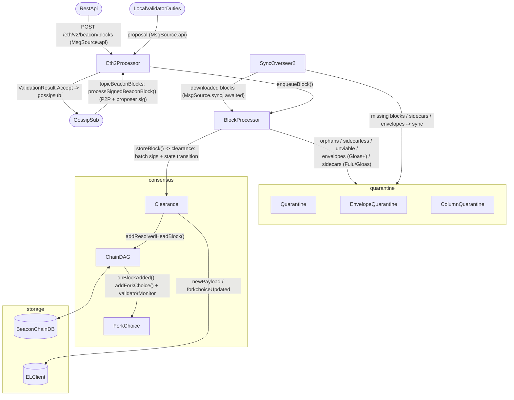

# Beacon Block Flow

This is a WIP document to explain the beacon block flows.

## Validation & Verification flow

Block verification relies on the following distinction:

- Block `validation` is defined in the [P2P specs](
  https://github.com/ethereum/consensus-specs/blob/v1.7.0-beta.0/specs/phase0/p2p-interface.md#beacon_block).
  A validated block can be forwarded on gossipsub.
- Block `verification` is defined in the [consensus specs](
  https://github.com/ethereum/consensus-specs/blob/v1.7.0-beta.0/specs/phase0/beacon-chain.md#block-processing).
  A verified block can enter fork choice, the DAG and the BeaconChainDB.

In particular in terms of costly checks validating a block only requires checking:
- the **block proposer signature** (checked eagerly, not batched; a small LRU of
  recently verified `(block_root, signature)` pairs gives a fast path for
  duplicate signatures)
- Internal consistency of the block

while verifying a block requires checking:
- the state transition
- all signatures within a block:
  - Randao Reveal
  - Proposer slashings
  - Attester slashings
  - Attestations
  - VoluntaryExits
  - BLS to execution changes
  - etc
- blobs

In-block signatures are collected into signature sets and batch-verified with a
`BatchVerifier` (nim-blscurve) during clearance, before the state transition
runs.

### Inputs

Blocks can be received from the following sources:
- Gossipsub
  - via `topicBeaconBlocks` (`&"/eth2/{$forkDigest}/{topicBeaconBlocksSuffix}"`).
    They are processed by [`processSignedBeaconBlock`](../beacon_chain/gossip_processing/eth2_processor.nim)
    which calls [`validateBeaconBlock`](../beacon_chain/gossip_processing/gossip_validation.nim)
- Sync protocol
  - via `SyncOverseer2` (when Nimbus syncs) — downloaded blocks are passed
    straight to `BlockProcessor.addBlock`
- [REST API](https://ethereum.github.io/beacon-APIs/#/Validator)
  - via `MessageRouter` (`routeSignedBeaconBlock` → `addRoutedBlock`) when a
    block is published via `POST /eth/v2/beacon/blocks`
- the NBC database
  - non-canonical branches are reloaded from the database when an orphan's
    parent was found there (`BlockProcessor.enqueueFromDb`)
  - era files provide access to deep history
- a local validator block proposal
  - proposals go through the same `MessageRouter.routeSignedBeaconBlock` path
    as RPC-published blocks
- Devtools: test suite, ncli, fuzzing

The base types are defined in the consensus specs.
On top, Nimbus builds new types to represent the level of trust and validation we have with regards to each BeaconBlock.
Those types allow the Nim compiler to help us ensure proper usage at compile-time and zero runtime cost.

#### ForkySignedBeaconBlock

A gossip-validated block of any known fork. This is the type that moves through
the gossip processing pipeline; it carries no trust guarantees beyond P2P
validation (proposer signature, no state transition).

#### ForkyTrustedSignedBeaconBlock / TrustedBeaconBlock

A block that has been verified both in regards to the state transition and its
cryptographic signatures is known as a `TrustedBeaconBlock` or `TrustedSignedBeaconBlock`.
This allows skipping expensive checks.
Blocks are considered trusted if they come from:
- the NBC database
- produced by a local validator
- the clearance (state transition + batch signature verification passed)

## Block processing architecture

How the various modules interact with blocks is described in a diagram:

The central component is the `BlockProcessor` which moves blocks from
"Incoming" to "Consensus verified". There is no shared block queue anymore —
instead the `BlockProcessor` serializes all block stores through a single
`storeLock` (`AsyncLock` + `pendingStores` counter), processing one block at a
time in arrival order:

- `BlockProcessor.enqueueBlock` is the fire-and-forget entry point for **gossip**
  blocks (it acts as an unbounded queue; blocks at or below the finalized head
  skip the queue entirely via `storeBackfillBlock`)
- `BlockProcessor.addBlock` is the awaited entry point for **sync** and **API**
  blocks (and for re-enqueued quarantined blocks)

The `BlockProcessor` holds a `ref ConsensusManager` which bundles the
`ChainDAGRef`, the `AttestationPool`, the `Quarantine` and the `ELManager` —
it is the single object through which block processing reaches the DAG, fork
choice and the execution layer.

### Gossip flow in

Blocks are listened to via the gossipsub topic `/eth2/{$forkDigest}/beacon_block/ssz_snappy` (`topicBeaconBlocks` variable)

They are then:
- validated by `processSignedBeaconBlock` in the Eth2Processor which calls
  `validateBeaconBlock` (in [gossip validation](../beacon_chain/gossip_processing/gossip_validation.nim), invoked with the DAG, the
  block `Quarantine` and the `EnvelopeQuarantine`) according to spec
  https://github.com/ethereum/consensus-specs/blob/v1.7.0-beta.0/specs/phase0/p2p-interface.md#beacon_block
- Important: P2P validation is not full verification (state transition and internal cryptographic signatures were not checked)
- enqueued in the BlockProcessor via `blockProcessor.enqueueBlock` in case of success
- dropped in case of error (or quarantined as orphans / sidecarless blocks when
  the parent or data columns are missing)

Logs:
- debug: "Block received"
- trace: "Block validated"
- debug: "Dropping block"
- debug: "Block quarantined"

### Gossip flow out

- After validation in `processSignedBeaconBlock` in the Eth2Processor by `validateBeaconBlock()` according to spec https://github.com/ethereum/consensus-specs/blob/v1.7.0-beta.0/specs/phase0/p2p-interface.md#beacon_block
- Important: P2P validation is not full verification (state transition and internal cryptographic signatures were not checked)
- We jump into libp2p/protocols/pubsub/pubsub.nim in the method `validate(PubSub, message)`
- which was called by `rpcHandler(GossipSub, PubSubPeer, RPCMsg)`

### Block syncing

Sync is driven by `SyncOverseer2` ([the sync overseer](../beacon_chain/sync/sync_overseer2.nim)).
Downloaded blocks (range sync, root sync, sidecar sync) are verified by sync
verifier callbacks which call `blockProcessor.addBlock(MsgSource.sync, ...)`
directly — there is no shared queue between sync and gossip processing.

The old standalone RequestManager is gone: fetching missing ancestor blocks is
now done by `SyncOverseer2` monitoring loops that watch the quarantine events
(`missingBlocksMonitoringLoop` on `quarantine.missingEvent`,
`missingSidecarsMonitoringLoop` on `sidecarlessEvent`,
`missingEnvelopesMonitoringLoop` on the envelope quarantine's `missingEvent`)
and feed the sync protocol (`beaconBlocksByRoot_v2`,
`beaconBlocksByRange_v2`, `dataColumnSidecarsByRoot`).

### Consuming blocks

`addBlock` serializes processing through `storeLock` (one block at a time, in
arrival order), calls `quarantine.startProcessing` and then
`storeBlock(Eth2Processor → BlockProcessor, ...)`:

- `dag.checkHeadBlock` — cheap pre-checks (duplicate, unviable fork, missing
  parent, slot ordering)
- execution validity via the EL (`newPayload`, with deadline ~1s before the
  next slot; may be skipped for blocks claimed finalized, or started early for
  Fulu blocks while waiting for data columns)
- `dag.addHeadBlockWithParent` (clearance): state transition on
  `clearanceState`, batch signature verification of all in-block signatures,
  then the block is linked into the DAG
- the `onBlockAdded` callback feeds the `AttestationPool` (fork choice) and the
  `ValidatorMonitor` (block, in-block attestation and sync aggregate
  registrations)
- `ConsensusManager.updateHead` (fork choice head update, triggers
  `checkExpectedBlock`) and `updateExecutionHead` (EL `forkchoiceUpdated`)
- on success, direct descendants are re-enqueued from the quarantine
  (`enqueueQuarantine`) and, since Gloas, the block's execution payload
  envelope is processed (`enqueuePayload`)
- on `MissingParent`, the block goes to `quarantine.addOrphan` (and non-canonical
  branches are reloaded via `enqueueFromDb`)
- on `UnviableFork`, the block is marked unviable so its descendants can be
  dropped promptly

Logs:
- debug: "Block processed"
- info/debug: "Block resolved"
- info: "Block batch signature verification failed"
- info: "Invalid block"
- debug: "Block from quarantine"
- debug: "Block backfilled"

### Quarantines

Blocks (and their side data) that cannot be processed yet are held in
quarantines until their missing dependencies arrive:

- `Quarantine` ([its implementation](../beacon_chain/consensus_object_pools/block_quarantine.nim)):
  - `orphans` (LRU, `MaxOrphans = SLOTS_PER_EPOCH * 3` = 96, keyed by
    `(root, signature)` so an invalid-signature block cannot evict the valid
    one) — blocks whose parent is missing
  - `sidecarless` (LRU, `MaxSidecarless = SLOTS_PER_EPOCH * 128` = 4096) —
    Fulu blocks whose data columns are missing
  - `unviable` (LRU, `MaxUnviables = 16 * 1024`) — blocks on a fork that does
    not include the finalized checkpoint, or that failed verification
  - `missing` (table, 1024 entries, 8 retries with exponential backoff) —
    roots the sync protocol should fetch
  - `seenProposerSlots` (LRU, `SLOTS_PER_EPOCH * 10`) — first-valid-block
    tracking per (slot, proposer)
  - `latest_sidecar_signatures` (LRU, 128) — fast path for re-verified
    proposer signatures
- `EnvelopeQuarantine` ([its implementation](../beacon_chain/consensus_object_pools/envelope_quarantine.nim), Gloas+): execution payload
  envelopes — `orphans` (96, keyed by `(block_root, builder_index)`),
  `missing` (1024), `unviable` (16 * 1024)
- `FuluColumnQuarantine` / `GloasColumnQuarantine` ([their implementation](../beacon_chain/consensus_object_pools/column_quarantine.nim)):
  PeerDAS data column sidecars for custody columns, accumulated per block root
  until enough are available to import the block (Fulu) or the envelope
  (Gloas). Memory budget: `SLOTS_PER_EPOCH * NUMBER_OF_COLUMNS / 4` = 3072
  sidecars, offloaded to disk up to 12× that (36864).

### Steady state (synced to head)
#### Active components when synced

- Gossip validators (`installMessageValidators` in [the beacon node setup](../beacon_chain/nimbus_beacon_node.nim))
  for blocks, execution payload envelopes (Gloas), data column sidecars,
  attestations, aggregates, sync committee messages/contributions, slashings,
  voluntary exits, BLS-to-execution changes, payload attestations, inclusion
  lists, light client updates
- `BlockProcessor` — the single serialized store path for gossip, API and
  sync-originated blocks
- `SyncOverseer2` monitoring loops (missing blocks / sidecars / envelopes /
  gossip blocks) — replaces the old RequestManager
- `BatchCrypto` for attestation / sync committee / KZG verification, with its
  eager verification gated on `blockProcessor.hasBlocks()` so block processing
  gets CPU priority
- `ChainDAG` clearance, `AttestationPool` fork choice,
  `ConsensusManager.updateHead` / `updateExecutionHead` (EL
  `newPayload` / `forkchoiceUpdated`), `ValidatorMonitor`, event bus queues
  (`blocksQueue`, `blockGossipQueue`, `blockGossipPeerQueue`)

#### Backpressure

There is no bounded queue in the block path: `enqueueBlock` is unbounded by
design (gossip blocks must not be dropped when they arrive concurrently with
sync, and must not block gossip propagation of seemingly good blocks). The
effective limits are the quarantine capacities (96 orphans, 4096 sidecarless,
16k unviable, 1024 missing), the column quarantine memory/disk budgets
(3072 / 36864 sidecars), the envelope quarantine (96 orphans, 16k unviable)
and the single `storeLock` serializing all block stores.

#### Latency & Throughput sensitiveness

When synced, blocks are a small part of the whole processing compared to attestations, there is no more throughput constraint however a single block should be processed ASAP as it blocks attestation flow (a block held up on `storeLock` delays everything behind it, and `hasBlocks()` disables eager attestation signature verification while any block is pending).

Furthermore to ensure the stability of the gossip mesh, blocks should be validated and rebroadcasted ASAP as well.
