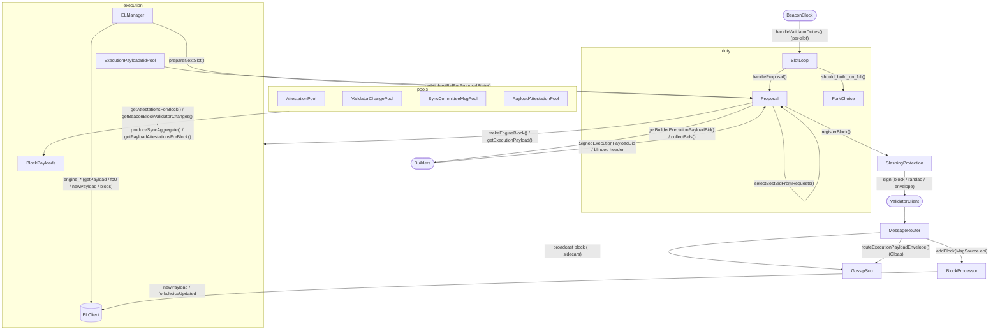

# Beacon Block Production Flow

This is a WIP document to explain the beacon block production flow — how a
validator duty turns into a signed block — and how the beacon node contacts
the execution client (EL) and external block producers (MEV builders), as of
the Gloas fork (a.k.a. Glamsterdam, which introduces execution payload
envelopes, PTC payload attestations and builder bids in the block body).

See [Beacon Block Flow](./block_flow.md) for what happens after a block is
produced and routed into the network.

## Overview

Block production is a beacon node duty: the beacon node builds the block and
the (attached) validator client only signs it. The flow is:

1. the per-slot loop (`BeaconClock`) calls `handleValidatorDuties`
   ([its implementation](../beacon_chain/validators/beacon_validators.nim))
2. `handleProposal` checks that one of our validators is the proposer for the
   slot and calls `proposeBlock`
3. `proposeBlockAux` builds the block ([in block payloads](../beacon_chain/validators/block_payloads.nim)), using the
   execution payload from the EL and — since Gloas — the best execution payload
   bid from the local engine and/or external builders
4. the block is registered with slashing protection, signed by the validator
   and routed via the `MessageRouter` (broadcast + `BlockProcessor.addBlock`)
5. since Gloas, the execution payload envelope is built, signed and routed
   right after the block (unless a builder bid was used — the builder reveals
   the payload later)

How the various modules interact is described in a diagram:

## Slot loop & duty gating

`handleValidatorDuties(node, lastSlot, slot)` runs once per slot and bails out
early when:
- the node is not synced: `info "Beacon node not in sync; skipping validator duties for now"`
- the EL is not in sync (`not head.executionValid`):
  `info "Execution client not in sync; skipping validator duties for now"` —
  the node then only does `handleFallbackAttestations`
- doppelganger detection is active and not yet ready:
  `notice "Doppelganger detection active - skipping validator duties while observing the network"`

It then decides `shouldExtendPayload` via
`attestationPool[].forkChoice.should_build_on_full(dag, head, headPayloadFull,
slot)` — since Gloas a block only *extends* the payload when the parent
payload is FULL (valid); otherwise it builds on an EMPTY payload. This flag is
also computed during EL warm-up (`prepareNextSlot`) so the EL prepares the
right payload.

`handleProposal` resolves the proposer for the slot
(`dag.getProposer(head, slot)`), finds the matching attached validator
(`getValidatorForDuties`) and calls `proposeBlock`. If no local validator is
the proposer: `debug "Expecting block proposal"`.

Duties for the upcoming slots (attestations, aggregation, PTC) are registered
ahead of time by `registerDuties` / `registerPTCDuties` into the
`ConsensusManager`'s `ActionTracker`.

## Block construction (Gloas)

`proposeBlockAux` ([its implementation](../beacon_chain/validators/beacon_validators.nim)):
- gets the proposal state: `dag.getProposalState(head, slot, cache)`
- if extending the payload, loads the parent's `execution_requests` from the
  parent's stored envelope (`dag.db.getExecutionPayloadEnvelope`) and applies
  them via `apply_parent_execution_payload`
  (`warn "Proposal parent payload is missing"` if absent)
- gets the randao reveal (`validator.getEpochSignature`)
- **starts the builder bid requests concurrently** with the local engine
  payload build (one `getBuilderExecutionPayloadBid` future per configured
  builder)
- fetches the engine payload: `getExecutionPayload` (see below)
- if the engine payload is unavailable, cancels the builder futures and
  **misses the slot** (no block is produced — the node would rather miss the
  slot than build from a stale payload)
- selects the best bid: `selectBestBidFromRequests` (see
  [External block producers](#external-block-producers-mev-builders))
- assembles the block: `makeEngineBlock` ([in block payloads](../beacon_chain/validators/block_payloads.nim)) which packs in:
  - attestations: `attestationPool[].getAttestationsForBlock`
  - validator changes: `validatorChangePool[].getBeaconBlockValidatorChanges`
  - sync aggregate: `syncCommitteeMsgPool[].produceSyncAggregate`
  - payload attestations: `payloadAttestationPool[].getPayloadAttestationsForBlock`
  - the execution payload + KZG commitments + execution requests
  - the selected `SignedExecutionPayloadBid` (external builder bid, or the
    self-build bid)
- slashing protection: `registerBlock` computes the block signing root and
  registers it with the slashing protection database before signing
  (`warn "Slashing protection activated for block proposal"` on conflict)
- signs: `getBlockSignature` (validator client)
- routes: `router.routeSignedBeaconBlock(signedBlock, checkValidator = false)`
  → gossip broadcast + `BlockProcessor.addBlock(MsgSource.api)`
- assembles the data column sidecars from the blobs/blobs proofs
  (`assemble_data_column_sidecars`)
- builds, signs and routes the execution payload envelope
  (`makeExecutionPayloadEnvelope` →
  `validator.getExecutionPayloadEnvelopeSignature` →
  `router.routeExecutionPayloadEnvelope`) — skipped when a builder bid was
  selected: `notice "Block uses builder bid, skipping envelope broadcast"`

Key logs: `info "Requesting engine payload"`, `info "Received engine payload"`,
`info "Using builder bid"`, `warn "Cannot create block for proposal"`,
`warn "Could not get block proposal signature"`, `notice "Block proposed"`,
`notice "Payload Envelope proposed"`.

## Execution client contact

All EL interaction goes through the `ELManager` ([the EL manager](../beacon_chain/el/el_manager.nim))
which holds one `ELConnection` per configured Engine API URL
(JWT-authenticated). Connections have a state machine
(`NeverTested → Working → Degraded` with hysteresis;
`"Connection to EL node degraded"` / `"Connection to EL node restored"`) and
requests are retried with exponential backoff until a deadline
(`retryUntilCancelled`); degraded connections are excluded from retries.
Multiple ELs are raced: `getPayload` picks the highest-value payload, and
`newPayload`/`forkchoiceUpdated` treat a disagreement between ELs as invalid
(`"Execution layer consensus violation detected"`).

The Engine API calls used:
- `engine_forkchoiceUpdated`
  - proposal warm-up (with payload attributes, see below)
  - head updates after every block import (`ConsensusManager.updateExecutionHead`)
  - light client head updates (`lightClientForkchoiceUpdated`)
- `engine_getPayload` — only at proposal time
  (Gloas: `GetPayloadV6Response`, Fulu: `GetPayloadV5Response`)
- `engine_newPayload` — at block import time in `BlockProcessor.storeBlock`
  (Gloas: the envelope's payload with the bid's blob KZG commitments and
  execution requests)
- `engine_getBlobsV2` / `engine_getBlobsV4` — sidecarless blob retrieval from
  the local EL blob pool (see below)
- `eth_chainId` — periodic sanity check (every 60 s)

### Proposal warm-up (`prepareNextSlot`)

At the end of each slot (after the payload-attestation offset, with a deadline
of ~1 s before the next slot start), the node is synced and the head is
execution-valid, `ConsensusManager.prepareNextSlot` runs:
- advances `dag.clearanceState` to the proposal slot so the expensive epoch
  transition is done before the block arrives
  (`debug "Prepared clearance state for next block"`)
- computes `should_build_on_full` for the next slot and builds the matching
  `PayloadAttributesV4` (timestamp, prev_randao, fee recipient, withdrawals —
  `get_expected_withdrawals` when extending, `payload_expected_withdrawals`
  otherwise — parent beacon block root, slot, target gas limit)
- sends `forkchoiceUpdated` with the attributes
  (`debug "Fork-choice updated for proposal"`); the response future is cached
  per connection (`lastPayloadReq`)
- emits the `payload_attributes` event (REST event stream)

At proposal time, `ELConnection.getPayload` reuses the cached prepared payload
request when the head block hash and attributes match; otherwise it sends a
last-minute `forkchoiceUpdated` with attributes
(`debug "Payload not prepared, sending last-minute payload request"`), waits
500 ms for the EL to build, then calls `getPayload`.

### Optimistic status handling

The EL's `PayloadExecutionStatus` maps to an `OptimisticStatus` per block:
`VALID` → `valid`, `SYNCING`/`ACCEPTED` → `notValidated` (optimistic),
`INVALID` → `invalidated`. A head with an optimistic status is not
`executionValid`.

- `ConsensusManager.expectBlock(slot)` completes via `checkExpectedBlock`
  (called from `updateHead`), but **refuses to fire while the head is
  optimistic** — this is what makes `handleValidatorDuties` wait for the EL
  before sending attestations (attestations are sent after
  `expectBlock(slot)` or the attestation deadline, whichever comes first)
- `ConsensusManager.updateExecutionHead` (called after every block import,
  retried until the deadline) runs `forkchoiceUpdated` for the new head; if a
  previously valid payload turns invalid, since Gloas only the payload's FULL
  fork choice node is invalidated (`forkChoice.mark_payload_invalid`) so the
  next head selection falls back to the EMPTY payload — instead of marking the
  whole root unviable as pre-Gloas
- when the EL is down, the node produces no blocks and only fallback
  attestations (see slot loop gating above)
- since Gloas, `ConsensusManager.expectEnvelope(blockRoot)` is the PTC
  analogue: it completes via `checkExpectedEnvelope` once the block's
  envelope *and* its data columns are persisted (in `BlockProcessor.storePayload`)

### Sidecarless blob retrieval (`GetBlobsService`)

[The blob retrieval service](../beacon_chain/el/el_getblobs_service.nim) implements sidecarless blob
retrieval: when a block arrives via gossip without its data column sidecars,
the service asks the local EL's blob pool for the blobs instead of waiting for
gossip. It consumes the block gossip event queue, calls
`elManager.getBlobsV2`/`getBlobsV4` (Gloas fetches only custody cells via a
column map bitvector), reconstructs custody columns and re-enqueues the
block/envelope into the `BlockProcessor`
(`"Engine GetBlobs service started"`, `"Added data columns from EL blobpool"`).

## External block producers (MEV builders)

### Fulu (legacy MEV-boost path)

Before Gloas, builder integration used *blinded blocks*:
- `collectBids` fetches the builder bid (`getHeader`) and the engine payload
  concurrently; `useBuilderPayload(BoostFactor)` compares them
  (`--local-block-value-boost`)
- builder win → `makeBuilderBlock` (blinded block from the builder header),
  `registerBlock`, sign, then `unblindAndRouteBlockMEV`
  ([the MEV message router](../beacon_chain/validators/message_router_mev.nim)): `submitBlindedBlock` to
  the relay with a 5 s timeout (`"Proposing blinded Builder API block"`);
  HTTP 202 means the relay accepted but didn't return a block (no local
  fallback); per the builder specs the validator **must not** fall back to
  the local EL after having signed a blinded block — fallback to the engine
  payload is only allowed before signing
  (`notice "Failed to create builder-based block, trying engine payload"`)

### Gloas (execution payload bids)

Since Gloas there are **no blinded blocks**: the node always builds a full
block from the local engine payload and embeds the chosen builder's
`SignedExecutionPayloadBid` in the block body; the builder later reveals the
payload (via the `execution_payload` gossip topic / builder API).

- builder configuration per validator: `builder_config.json` (keymanager) or
  CLI defaults (`--payload-builder-url`, `--builder-min-bid`,
  `--builder-boost-factor`, `--builder-max-execution-payment`) —
  `getBuilderConfig`
- bid requests: `getBuilderExecutionPayloadBid` signs a `BuilderRequestAuth`
  for the builder's auth data, then calls the builder's
  `getExecutionPayloadBid` endpoint, bounded by
  `BUILDER_PROPOSAL_DELAY_TOLERANCE = 1500.milliseconds`
  (`debug "Builder getBid API: success|request timeout|invalid bid|failed to get bid"`)
- bid selection: `selectBestBidFromRequests` merges the per-builder request
  bids with the gossip pool bid (`executionPayloadBidPool[].getHighestBidForProposalState`,
  gated on `dag.payloadAvailability`), checks builder pubkey allowlists
  against `state.data.builders[bid.builder_index]`, caps
  `execution_payment` at `max_execution_payment`, applies `min_bid`, and
  picks the best by `builder_boost_factor × value` against the engine value
  (`info "Using builder bid"`;
  `debug "Payload failsafe in effect, ignoring builder bids"` when the
  payload failsafe is active)
- self-build: when no builder bid wins, the block commits a self-build bid
  (`makeSignedExecutionPayloadBid`: `builder_index = BUILDER_INDEX_SELF_BUILD`,
  value 0, infinity signature, block hash from the EL payload)
- after routing a block that uses a builder bid, the node skips broadcasting
  its own envelope — the builder reveals the payload
- `submitBlockToBuilder` ([the MEV message router](../beacon_chain/validators/message_router_mev.nim), POST
  `submitSignedBeaconBlock`, 5 s timeout, 202 = ok) is still used when a
  validator client publishes a block via `POST /eth/v2/beacon/blocks` with an
  `eth-builder-url` header; `POST /eth/v2/beacon/blinded_blocks` returns 400
  for Gloas and `GET /eth/v1/beacon/blinded_blocks/{id}` returns 404

### Proposer preferences

Since Gloas, proposers broadcast `ProposerPreferences` (dependent root,
proposal slot, fee recipient, target gas limit) for their upcoming proposal
slots (`sendProposerPreferences`, signed via
`getProposerPreferencesSignature`, routed via `router.routeProposerPreferences`)
so builders can prepare bids with the right fee recipient and gas limit.

## Payload attestations (PTC, Gloas)

Payload-attestation duties for participation-tracking-committee (PTC) members
are registered per epoch (`registerPTCDuties` →
`actionTracker.registerPTCDuty`). Each slot, `sendPayloadAttestations`
([its implementation](../beacon_chain/validators/beacon_validators.nim)):
- only attests if the head is a block for the attested slot
- waits until the payload deadline for
  `consensusManager[].expectEnvelope(blck.root)` to decide
  `payload_present`; otherwise waits until the payload-attestation deadline
  and checks `blob_data_available` via `checkBlobDataAvailable` (custody
  columns in the DB)
- signs `PayloadAttestationData(beacon_block_root, slot, payload_present,
  blob_data_available)` via `getPayloadAttestationSignature` and routes it via
  `router.routePayloadAttestationMessage`

## Failure modes

- **EL down / not in sync**: no blocks are produced; only fallback
  attestations are sent (`"Execution client not in sync; skipping validator duties for now"`)
- **`getPayload` timeout**: the proposal is missed entirely
  (`"Engine payload is not available"`, no stale-payload fallback)
- **`newPayload` invalid at import**: the block is rejected or marked
  invalidated (`"execution payload invalid from EL client newPayload"`); at
  head update time only the FULL payload fork choice node is invalidated and
  the head falls back to the EMPTY payload
  (`"updateHeadWithExecution: attempting to recover from invalid payload"`)
- **builder timeout / invalid bid**: falls back to the engine payload
  (`"Builder getBid API: request timeout"`)
- **slashing protection conflict**: the proposal is aborted before signing
  (`"Slashing protection activated for block proposal"`)
